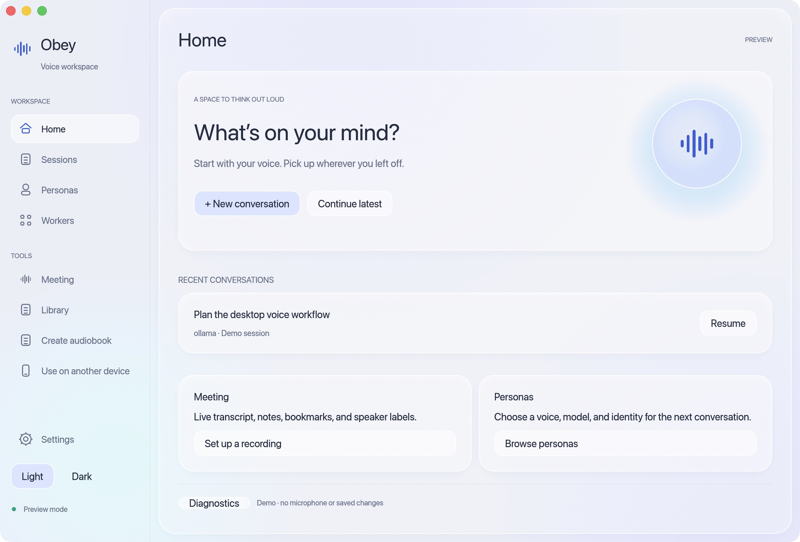
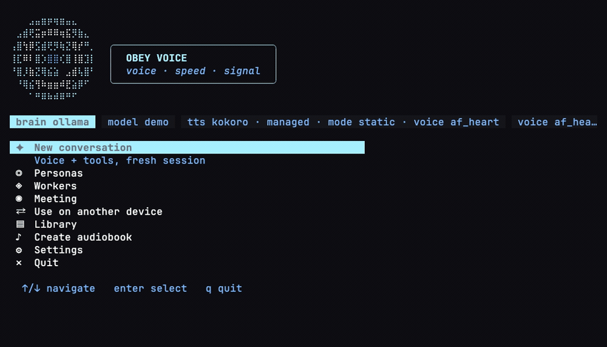

<h1 align="center">Obey Voice</h1>

<p align="center">
  <strong>Fast, private, actually useful.</strong><br>
  Voice agents, audiobooks, meeting notes, and scriptable speech — built around local models.
</p>

<p align="center">
  <a href="go.mod"></a>
  <a href="#install"></a>
  <a href="https://github.com/Obedience-Corp/festival"></a>
</p>

<p align="center">
  Talk to your agents, turn your reading into audio, and build voice into your own workflows.<br>
  Native macOS app · terminal interface · scriptable CLI
</p>

<p align="center">
  <a href="#install">Get started</a> ·
  <a href="#what-you-can-do">What you can do</a> ·
  <a href="#audiobooks-and-narration">Audiobooks</a> ·
  <a href="#meeting-notes">Meetings</a> ·
  <a href="#scriptable-voice">Scripting</a> ·
  <a href="#group-chat">Group chat</a> ·
  <a href="docs/README.md">Docs</a>
</p>

## What you can do

| Use it for | What you get |
|------------|--------------|
| **[Voice agents](#group-chat)** | Streaming conversation, interruptions, background work, and multiple personas with their own voices and models. |
| **[Ebook → audiobook](#audiobooks-and-narration)** | EPUB and digital PDF narration, chapter/page audio, resumable renders, and optional Calibre library browsing. |
| **[Articles and documents → audio](#audiobooks-and-narration)** | Read text, Markdown, HTML, and web articles aloud into audio files, or pipe text in from another program. |
| **[Meeting notes](#meeting-notes)** | Live transcripts, timestamped notes and bookmarks, speaker labels, and saved Markdown you can route into your workspace. |
| **[Scripted dialogue](#scriptable-voice)** | Record two personas reading a script in their own voices, or have them generate dialogue from a scene brief. |
| **[Speech in your own tools](#scriptable-voice)** | Batch commands, JSON results, a timed transcription protocol, and a Go library for embedding the voice agent. |

<p align="center">
  <br>
  <em>Native macOS app with sample conversations.</em>
</p>

<p align="center">
  <br>
  <em>Three personas, one conversation. Real terminal UI with fixture replies.</em><br>
  <a href="demos/README.md#readme-demo">Reproduce the demo</a> with <code>just demo</code>.
</p>

---

## The lab

I'm building Obey Voice to find out how useful voice can be when the models run locally: talking through work with an agent, listening to a book, capturing a meeting, or adding speech to a script.

The same speech stack powers live conversations and batch audio jobs. In conversation, it speaks as sentences arrive, stops when you interrupt, and lets you give each agent its own voice and personality. You can swap models, try different routing decisions, and measure what changes.

## Choose your brain

Ollama is the default. With local speech models, conversation and routing can run on your hardware after setup. You can also connect Claude Code, [Codex](docs/codex.md), Cursor, Grok, [Muse Spark](docs/muse-spark.md), or the [Obey daemon](docs/obey-daemon.md).

Keep conversation local and use another provider for background work, or choose a remote brain for the whole conversation. Remote providers receive the text you send them; web tools also use the network. Choose your model in **Settings → Brain**. [Provider and worker settings](docs/configuration.md).

## Install

See the [installation guide](docs/install.md) for app and terminal setup. To build from source, start with a checkout:

```bash
git clone https://github.com/Obedience-Corp/obey-voice.git
cd obey-voice
```

### macOS app

Install Rust 1.95, Go 1.26.1+, Python 3, Xcode Command Line Tools, and [just](https://github.com/casey/just).

```sh
just desktop install
open "$HOME/Applications/Obey Voice Agent.app"
```

Follow first-launch setup to choose providers and download models. Allow microphone access when prompted. Quit the app before reinstalling. [Desktop install guide](docs/install.md#desktop-app-macos).

### Terminal (macOS / Linux)

Requires Go 1.26.1+, `just`, and a C compiler.

```bash
just install
obey-voice doctor --voice-devices
obey-voice
```

Put your Go binary directory on `PATH` (`$GOBIN`, or `$(go env GOPATH)/bin`). On macOS, give your terminal microphone access. Choose a model in **Settings → Brain** before starting a conversation. [Full install guide](docs/install.md).

## Audiobooks and narration

Turn an EPUB or digital PDF into audio with your configured TTS voice. Audiobook creation writes a WAV per EPUB chapter or PDF page plus a manifest; `--resume` skips unchanged completed sections and retries failed ones. Browse and select books from your **Calibre library**, or pass a file directly.

```bash
# Make an audiobook, with optional MP3 output alongside the WAV files (needs ffmpeg).
obey-voice audiobook create book.epub --out-dir out/book --audio-format mp3

# Continue a long render without starting over.
obey-voice audiobook create book.epub --out-dir out/book --audio-format mp3 --resume

# Turn an article or document into a single recording.
obey-voice render article.md --out out/article.wav
```

Text, Markdown, HTML, and article URLs work with `render` too. Digital PDFs require Poppler's `pdftotext`. Batch narration uses TTS without a microphone or a conversation brain. For voice selection, section pauses, Calibre setup, and the prompt-controlled narration pipeline, see [Narration and audiobooks](docs/narration.md).

## Meeting notes

Capture a meeting while you participate. The recorder transcribes continuously, lets you type notes and bookmark important moments, and saves a timestamped Markdown transcript in a `.meeting` bundle. Live speaker labels help follow the conversation; offline speaker analysis runs after capture stops.

```bash
obey-voice meeting record --description "Weekly planning"
obey-voice meeting record --resume last
```

In the terminal recorder, type a note and press **Enter** to save it at the current timestamp; **Ctrl+B** marks an important moment. Resume adds to the same meeting. Route notes to a configured file or campaign destination, including [camp](https://github.com/Obedience-Corp/camp) meeting notes. Capture uses speech recognition without a conversation brain or spoken replies. [Meeting guide](docs/meetings.md).

## Scriptable voice

Use speech from shell scripts and other programs. Batch rendering accepts stdin, writes audio and manifests, and offers JSON summaries and nonzero exits on failure.

```bash
# Give another program's text output a voice.
printf 'The build is ready for review.\n' | obey-voice render --stdin --out out/status.wav

# Render a document by section and save a machine-readable result.
obey-voice render report.md --out-dir out/report --resume --json > render-result.json
```

**Produce dialogue.** `obey-voice scene script.yaml --out-dir out/scene` records a YAML script with exactly two installed personas, each using its own voice. It writes individual turns, a combined recording, and a manifest with timings. You can also supply a scene brief and let the personas generate their lines. [Scene format and examples](docs/scene.md).

**Transcribe recordings from another tool.** `obey-voice transcribe --request /absolute/job/request.json --jsonl` accepts a request describing a finished 16 kHz mono WAV and streams timed transcript events. [Request format and client example](docs/transcribe-protocol.md).

**Build your own interface.** Use the [Go embedding example](examples/embed/README.md) to run the voice agent inside another application, or connect a client through the [HTTPS/WebSocket serve protocol](docs/serve-protocol.md). For phone or tablet access, choose **Use on another device** in the TUI. [Remote access guide](docs/usage.md#remote-access-phone--another-device).

## Group chat

Give each persona a voice, model, and prompt. Personas using different brain providers can share the same conversation. Say “Jarvis, what do you think?” to bring one in; the last speaker handles follow-ups. Agents can hand questions to each other, and you can interrupt at any time. [Set up personas](docs/personas.md).

## Explore

- [Usage](docs/usage.md): text input, phone access, and terminal controls.
- [Voice stack](docs/voice-stack.md): pipeline diagram and speech models.
- [Benchmarks](docs/benchmarks/README.md) and [conversation scenarios](tests/convoflow/README.md): compare models, latency, and routing.
- [Pipeline debugging](docs/pipeline-debugging.md): inspect live turns or replay recorded conversations.
- [All docs](docs/README.md): feature guides, configuration, protocols, and development.

Built with [Festival](https://github.com/Obedience-Corp/festival), with optional festival integration (meeting note routing and persona working directory assignment).

[Contributing](CONTRIBUTING.md) · [Issues](https://github.com/Obedience-Corp/obey-voice/issues) · [AGPL-3.0-only license](LICENSE) · [Contributor agreement](CLA.md) · [Notice](NOTICE)

---

<p align="center">
  Built by <a href="https://obediencecorp.com">Obedience Corp</a> ·
  <a href="https://github.com/Obedience-Corp">GitHub</a>
</p>
