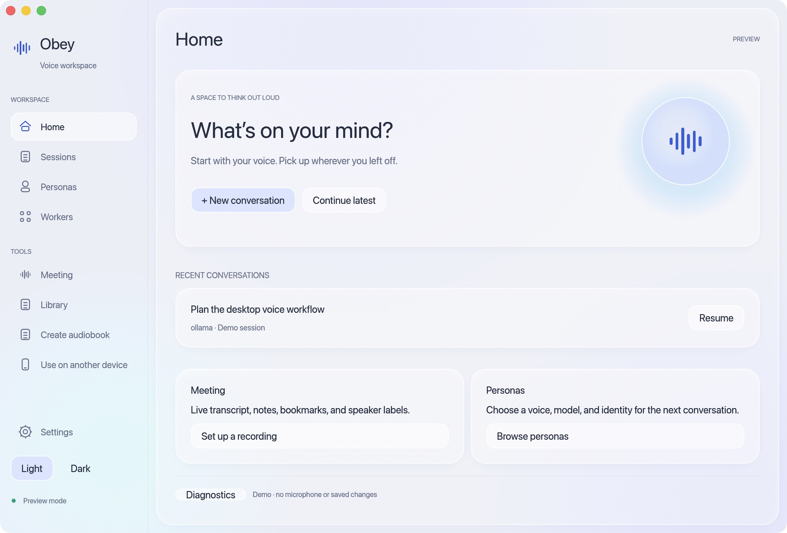
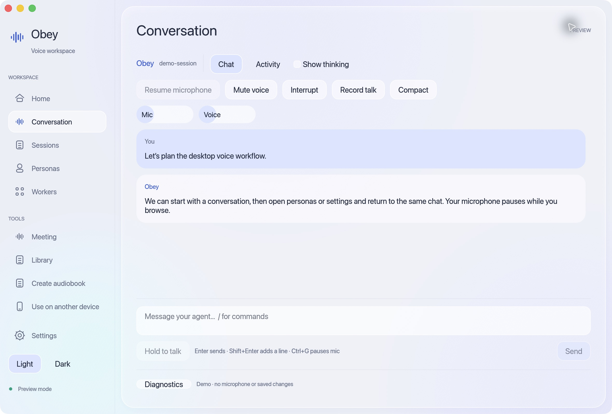
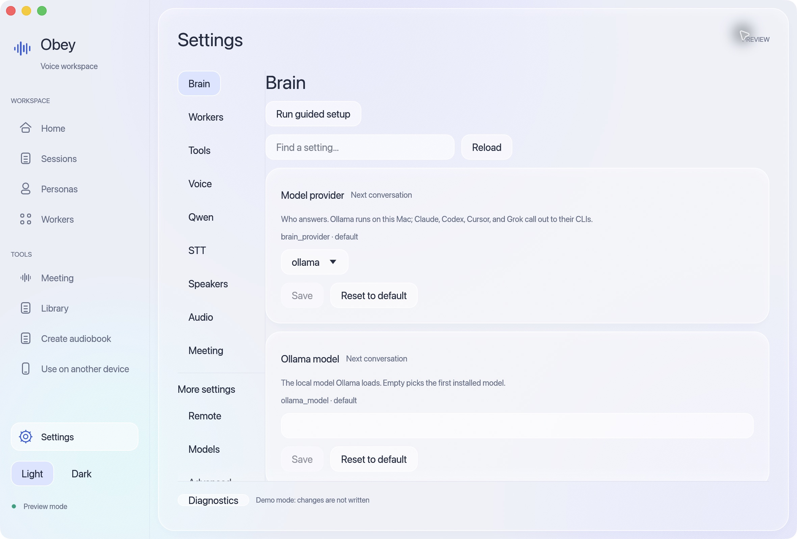

# Obey Voice Agent

A native window for talking to your agents, resuming conversations, managing
personas, and choosing models and voices. The app uses the same configuration,
personas, sessions, models, and library as the Obey Voice CLI.



## Install on macOS

From a full checkout of the repository, with Rust 1.95, Go 1.26.1+, Python 3,
Xcode Command Line Tools, and `just` installed:

```sh
just desktop install
open "$HOME/Applications/Obey Voice Agent.app"
```

Source builds need authenticated Git access to the private Obedience-Corp Go
modules; `GOPRIVATE` must include `github.com/Obedience-Corp/*`. The command
builds an optimized app, includes its voice engine and native speech libraries,
and verifies the local ad-hoc signature before installing into `~/Applications`.
Quit the app before running the command again to update it. A different
installation directory can be passed as an argument:

```sh
just desktop install "/path/to/Applications"
```

On first launch, guided setup helps you choose and check a brain provider,
configure speech, and install required models. Existing CLI settings and
personas are reused. Allow microphone access when starting a voice conversation;
typed-only and silent modes are also available. Closing the window keeps the
app in the menu bar by default; use **Quit Obey** to exit completely.

This is a local source installation, ad-hoc signed rather than Developer ID
signed and notarized. macOS is the validated desktop platform. Windows bridge
startup is currently disabled because native library output cannot yet be
safely isolated from its JSONL protocol. See the [full install guide](../../docs/install.md#desktop-app-macos).

## Inside the app

**Conversation** keeps the transcript, composer, voice controls, and activity
within reach.



**Settings** groups the engine's options by task, including brain selection,
voice, audio, workers, and model installation.



These are screenshots of the real app in preview mode with sample data and
engine defaults. No microphone, personal conversations, or credentials were
used. Run `just desktop demo` from the repository root to explore the preview.

## Build and run

Requires Rust 1.95 (pinned by `rust-toolchain.toml`), Go 1.26.1+, a C compiler, and `just`. Authenticate Git access to the private Obedience-Corp dependencies first. Configure `GOPRIVATE` to include `github.com/Obedience-Corp/*` if it is not already configured.

From the repository root:

```sh
just desktop build
just desktop run
just desktop check
```

The commands below run from `apps/desktop`; its local Justfile remains available.
See [monorepo development](../../docs/desktop-development.md) for layout and CI.

The Go companion is built into `bin/obey-voice-engine`. The Rust UI finds it beside the desktop executable, then in `apps/desktop/bin`. `OBEY_VOICE_ENGINE` can select an explicit companion path. The bridge uses the engine in this repository through `replace github.com/Obedience-Corp/obey-voice => ../../..` in `bridge/go.mod`. No engine revision update or sibling repository is needed. Keep the full checkout when building the app; copying only `apps/desktop` is not supported.

For macOS:

```sh
just bundle
just bundle-release  # optimized Rust build
```

Open `dist/Obey Voice Agent.app`. Both commands replace this local bundle, include the companion and native speech libraries, and verify its ad-hoc signature. They do not install or publish the app. Public distribution would require Developer ID signing and notarization.

## Development commands

Run `just` for help, or `just --list --list-submodules` for every recipe. The root Justfile provides common entry points and delegates to focused modules under `.justfiles/`.

| Module | Commands | Purpose |
|--------|----------|---------|
| `dev` | `bridge`, `build`, `release`, `run`, `demo` | Go companion, debug/optimized Rust builds, local runs |
| `lint` | `all`, `justfiles`, `fmt-check`, `fmt`, `clippy`, `go-vet` | Read-only checks; `fmt` explicitly applies Rust formatting |
| `test` | `all`, `rust [filter]`, `bridge [pattern]`, `ui` | Automated tests and an opt-in interactive fixture |
| `dist` | `mac`, `mac-release`, `install [directory]`, `verify` | Local macOS packaging, installation, and signature verification |

`just check` is the complete unattended gate: Justfile/Rust formatting, Clippy, Go vet, Rust tests, Go race tests, and a debug build. It does not launch the app, open audio devices, or run hardware acceptance. `just test` retains its original behavior and runs both automated suites.

```sh
just test rust malformed_protocol
just test bridge 'TestProtocolOutput|TestDesktopTextRoundTrip'
just build-release
just dist verify
```

`just run` accepts app arguments, for example `just -- run --text-only --silent`. Runs use Cargo, and bundling reads Cargo metadata, so a configured `CARGO_TARGET_DIR` is respected. `just dev check` and `just dev test` remain available as compatibility entry points; the former retains its original lint-only behavior.

## Workflow

- **Home / Sessions:** start a conversation, choose a persona or saved default, resume history, or confirm deletion. Typed-only and silent modes are available in the start dialog.
- **Conversation:** streaming replies, optional thinking, activity, input/output levels, microphone pause, output mute, interrupt, hold-to-talk, recording, compaction, and slash commands. Enter sends; Shift+Enter adds a line. Ctrl+G pauses the mic, Ctrl+O mutes voice, Ctrl+T opens activity, and Ctrl+K toggles thinking. The composer uses native text editing; terminal Vim mode is not implemented.
- **Personas:** use the existing persona store, select a default, choose an in-chat responder, and create/edit/enable/disable/delete profiles. In-chat selection preserves the global default and finalized reply identity. Structured prompts retain their source-document editor.
- **Settings:** search the engine's configuration schema, edit defaults, inspect persona overrides, install/check models, run diagnostics, preview the saved voice, and register speakers from an open voice conversation.
- **Workers:** inspect/cancel tasks, control delivery, enable workers, and edit tier assignments, limits, and spending policy with revision checks.
- **Meeting:** record, pause, resume, annotate, bookmark, stop, review history, and file notes to a destination.
- **Library / Create audiobook:** select a Calibre book or an input file, choose narration options, and monitor or cancel rendering.
- **Use on another device:** run the existing remote server on Wi-Fi or Tailscale and display the address/pairing code. Leaving this screen stops sharing.

Managers retain the active conversation and pause voice admission. Leaving conversation/managers for another workflow saves and closes the chat. The launcher never opens the microphone. Model downloads and provider requirements follow the engine's existing configuration.

## Architecture

The desktop UI is Rust, using egui/eframe and wgpu (Metal on macOS). A supervised Go companion runs the **existing** Obey Voice conversation controller over private stdin/stdout JSONL. Speech, persona bindings, worker policy, meeting persistence, and session stores remain owned by Obey Voice. Local conversations do not start an HTTP server.

`src/app.rs` owns application state and initialization. Its `app/` modules handle
actions, engine events, preview data, and the window layout. Each workflow has a
module under `screens/`; shared controls and dispatch stay in `screens.rs`.
`backend/` separates command execution, process lifecycle, and bridge protocol
handling. `theme/` separates drawing and native appearance from shared styling.

Hand-maintained files have a 500-line maximum, including comments and blank lines.
`just lint file-size` checks tracked and unignored new text files, and runs as part
of `just check`. Generated dependency records are exempt. Split by responsibility
instead of compressing code to meet the limit.

The exported runtime adapter was introduced by [obey-voice #227](https://github.com/Obedience-Corp/obey-voice/pull/227). The bridge and engine are now tested together in this repository.

Settings use the TUI’s section order: Brain, Workers, Tools, Voice, Qwen, STT,
Speakers, Audio, and Meeting. Extra engine configuration remains under Remote,
Models, and Advanced. Brain shows the saved provider’s model; global search also
finds other providers’ settings. Claude session limits are under Advanced →
Claude session management and only affect the Claude brain provider. The engine
continues to own setting validation and persistence.

The app icon uses the existing Obedience Corp mark; see [asset provenance](assets/README.md).

## First-time setup

The first launch opens **Welcome → Brain → Speech → Audio → Try it**. Existing
Obey Voice configuration is detected and retained; existing users can choose
**Keep my setup and go to Home**. You can reopen setup from Home or Settings.

Choose a provider and save its model/server choices, then check it. Ollama checks
reachability and installed models; CLI providers check installation and use their
existing login. Sign in through the provider's CLI before the final conversation.
An active persona can override app defaults, and the test uses that same persona.

Select microphone input and spoken replies independently. Model checks are
read-only; installation starts only when selected, with download progress,
cancellation, and retry. Turning both audio options off skips speech downloads and
hardware. Starting the audio test explicitly opens the microphone when selected.
The final greeting verifies a real provider reply; enabled audio also requires
confirmation that the input meter responds and playback is audible.

Setup saves its current step, audio choices, and completion/skip status in
`desktop-setup.json` under the engine's config directory. It does not replace
`config.yaml`. Unfinished setup resumes after restart; skipped setup remains
available from Home. Completion means the test succeeded at that time, not a
permanent health guarantee. **Engine connected** only reports the bridge connection.

## Verification and previews

```sh
just check       # lint, automated tests, and debug build
just test        # Rust tests and isolated Go bridge tests with the race detector
just demo        # sample data only; does not read your personas or use the mic
just ui-fixture  # builds an isolated test app and runs a mock local model server
just test setup # same real engine fixture, initially without config.yaml
just test setup-replay # simulated audio, failed/cancelled downloads, provider retry
```

`just demo` is only a visual preview. Use `just run` or the normal app bundle to load your actual personas. The UI fixture prints a separate test app path; open that app, choose application defaults, typed-only, and silent output, then exercise a conversation. Fixture state stays under the printed temporary directory. Stop the fixture server when finished.

`just test ui` and `just ui-fixture` are equivalent macOS-only, interactive commands. They build the debug bundle and keep the mock server running until Ctrl+C. Real microphone/speaker and other hardware acceptance remain explicit manual checks; they are not part of `just check` or `just test`.

Automated tests cover typed response persistence/resume, unavailable actions, invalid session paths, stale worker policy writes, empty Go collections, and immutable reply identity. Native-window checks cover appearance, configured personas, and the text workflow. Live microphone, speech output, meeting diarization, remote-device pairing, and audiobook rendering still require hardware/provider acceptance on your setup.

### Debugging the desktop and voice engine

Use **Diagnostics** in the page footer to inspect recent events, filter by error or
request ID, and copy the log path or visible records. `just logs` follows the latest
run in a terminal, including app restarts (`just logs --demo` for previews).

On macOS, logs are in `~/Library/Logs/obey-voice-agent/`. Other platforms use
`$XDG_STATE_HOME/obey-voice-agent` (default `~/.local/state`) or
`%LOCALAPPDATA%/obey-voice-agent`. Set `OBEY_VOICE_LOG_DIR` to choose another directory.
Each run writes JSONL with epoch-millisecond timestamps, request IDs, bridge
generations, command durations, lifecycle events, engine stderr, state/activity
summaries, and Rust warnings/errors. `OBEY_VOICE_TRACE_UI=1` additionally records
eframe repaint scheduling for UI performance debugging.

Writes happen off the UI thread. Each run retains a current 5 MiB segment and one
previous segment; startup prunes older run files to keep eight before adding the
new run. Recent records remain visible even if the log file cannot be written.
The queue and viewer are bounded, and dropped records are counted. Protocol logs
omit conversation text, prompts, config values, and reply bodies. Engine stderr
is recorded as emitted, so review diagnostics before sharing them.

Meeting capture shows live partial/final transcripts, microphone activity, and a
separate note editor. Notes clear only after the engine acknowledges saving them.
Saved meetings have a campaign picker and an optional configured destination ID.
Delivery uses the existing engine router; failed receipts remain failures even
when the command exits successfully. The app includes standard Go, user, and
Homebrew executable directories for Finder launches. `OBEY_VOICE_TOOL_PATH`
overrides that search path for custom installations or isolated tests.

`just test events` builds an isolated protocol-replay app for startup failures,
live transcript/notes, and routing receipts. It never opens audio devices or loads
personal config. `just test routing` exercises the real engine router with a
temporary meeting/config and a fake camp importer, verifying the saved document
and failed-delivery receipt. The existing `just ui-fixture` remains the real engine
text-conversation fixture. Hardware/provider acceptance is still manual.

The setup replay never opens hardware or contacts a model provider. Its first
installation fails, its second waits for cancellation, and its third succeeds.
Its first greeting fails and its second replies, allowing the completion gate to
be checked. Fixture window/appearance preferences and logs are isolated too.

## Menu bar and Linux tray

Obey keeps an Obedience Corp icon in the macOS menu bar or a Linux
StatusNotifierItem-compatible panel. Click to show the existing window. On macOS,
right-click for controls; on Linux use the panel's icon menu.

The menu opens a new conversation or meeting setup, pauses/resumes the active
microphone or meeting, stops and reviews a meeting, opens Settings/Diagnostics,
and quits. Starting capture still requires the existing setup screen. Controls
are disabled during setup and conflicting operations. Status text and colored
badges reflect engine state: green microphone, red meeting, amber pause, orange
attention. Active capture remains visible if an unrelated error occurs.

With **Settings → Advanced → Keep in menu bar / tray** enabled (the default),
closing hides the window and keeps any current recording running. **Quit Obey**
(or Command-Q on macOS) exits through engine shutdown. Reopening from Finder or
the Dock restores the existing macOS window. Turning the preference off removes
the icon and restores normal close-to-quit behavior.

Linux requires a running StatusNotifierItem host, not just a watcher service.
Without one, closing quits normally; if the panel disappears while Obey is
hidden, the window returns. Tray failures and activity transitions appear in
Diagnostics and `just logs`. Linux builds require the D-Bus development package
(`libdbus-1-dev` on Debian/Ubuntu). `just test linux` compiles/tests in Docker and
exercises panel absence, return, and loss on a private D-Bus session. No login
item or background service is installed.

Persona settings support an optional starting directory, registered local camp
selection, custom entry and Browse. Empty uses the app default. Changes apply
to new conversations; the conversation header shows the saved directory that
remains in use across responder changes and resume. Camp discovery uses the
engine's `persona directories --json` command and stays optional. The Linux
folder browser uses `zenity`; custom entry remains available if it is absent.

This feature uses the shared engine support introduced in
[obey-voice #228](https://github.com/Obedience-Corp/obey-voice/pull/228).

## Current engine features

Persona brain and speech selectors read the engine configuration schema, including
Codex, audio8, and openai-speech. The inherited App default option remains available;
saved providers remain visible if discovery fails.

Speech setup shows the openai-speech server URL, model, voice, API key and timeout.
The server owns installation (for local Phonon, run `ollama pull phonon`). The final
Try it step verifies generation and playback; an empty local model list does not
prove server readiness.

Conversation shows active and queued background work without replacing the main
conversation status. Select the indicator to open one task directly or the worker
list for multiple tasks. Stopping tasks stay visible until the engine finishes
them; disabling new tasks does not hide existing work.

`just test work` opens an isolated protocol replay for this indicator: start a
typed/silent conversation, inspect the active and queued jobs, return to chat,
and send `finish` to complete them. It never opens audio or reads personal config.

The persona editor is a centered modal with Intelligence and Voice sections, an
optional starting-folder section, and fixed save/cancel actions. Its form scrolls
independently so the actions remain reachable in smaller windows.
