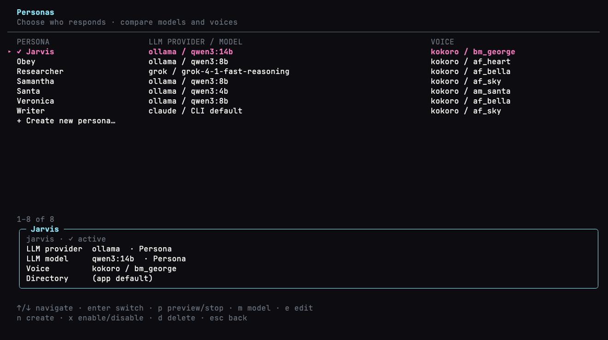

# Demos

## README demo

`just demo` builds the current binary and records `demos/readme.tape` into
`docs/images/tui.gif`: launcher → persona picker → listening/hearing/speaking
activity and a reply. The real Bubble Tea TUI runs in a VHS terminal.

The fixture uses a temporary home, a loopback model stub, and the existing
scripted voice events. It needs no microphone, playback, downloaded models,
credentials, or personal configuration. Voice activity is simulated; this is a
UI walkthrough, not an inference or latency benchmark.

Color is forced in both the recorder and child process, including when the
calling shell sets `NO_COLOR`. The GIF uses the terminal palette and is optimized
for the README. Requirements: `vhs`, `ffmpeg`, `python3`, and the normal build tools.

## tool-calls.gif — main Obey Voice TUI + live tool call

Full Bubble Tea UI (not `--no-tui`):

1. **Launcher** — New conversation  
2. **Chat** — `Obey · Chat · Activity`  
3. **Tools** — `list_files` start/finish lines in the transcript  
4. Obey’s reply after the tool result  

Recorded from the real Bubble Tea binary in a VHS PTY, using the same dark
terminal palette and compact geometry as termcast. The checked-in GIF is the
palette-optimized 960px version; there is no fake shell transcript or static
mock screen.

```bash
just demo-tool-calls
```

The recipe builds `./bin/obey-voice`, runs `vhs demos/tool-calls.tape` against a
disposable `$HOME`, then applies the termcast-style 20fps/960px palette pass.

Still frames: `demos/frames/launcher.png`, `demos/frames/chat-tools.png`

## conversation-record.gif — /record talk seals a capture bundle

Full Bubble Tea conversation UI:

1. **Chat** — start a conversation (`-t -n`, no live mic)
2. **`/record talk`** — footer `rec` chip, bundle under `captures/`
3. **Admit error** — scripted `veronica` collision (WI-051146) lands in Activity
4. **`/record off`** — seals `events.jsonl` + `manifest.json`
5. **Shell** — `find captures` and `rg ambiguous events.jsonl`

`OBEY_VOICE_DEMO_CAPTURE=1` emits the admit error on the live bus. No live model.

```bash
just demo-conversation-record
```

## think-blocks.gif — show thinking in the thread

Full Bubble Tea conversation UI with a scripted thinking turn (no live model):

1. **Ask** — `Why is the sky blue?`
2. **Live thinking** — dim `thinking` block streams in
3. **Reply** — the thinking block leaves; only the spoken answer stays
4. **Ctrl+K** — thinking returns above the reply as a thinking block
5. **Ctrl+K** — hide it again

`OBEY_VOICE_DEMO_THINK=1` emits the same `ThinkingDelta` / `ResponseReady`
events production turns use. Default remains speakable-only; the shortcut
is a session toggle (`/think` is the slash-command twin).

```bash
just demo-think-blocks
```

Still frames: `demos/frames/think-live.png`, `demos/frames/think-hidden.png`, `demos/frames/think-shown.png`

## workers.gif — background job manager with pretty JSON

Full Bubble Tea workers screen:

1. **Launcher → Workers**
2. **List** — running job with activity *summary* (not a JSON dump)
3. **Detail** — indented, syntax-colored tool JSON

`OBEY_VOICE_DEMO_WORKERS=1` injects a fixture search job. No live model.

```bash
just demo-workers
```

Still frame: `demos/frames/workers-detail.png`

## work-cue.gif — background work during conversation

The real conversation TUI shows an animated **Working** cue beside the
listening meter while Jarvis answers a follow-up. `Ctrl+W` opens the running
worker's detail. `OBEY_VOICE_DEMO_WORK_CUE=1` scripts bus events and uses the
workers fixture, so recording needs no live microphone or model.

```bash
just demo-work-cue
```

Still frames: `demos/frames/work-cue-listening.png`,
`demos/frames/work-cue-followup.png`, `demos/frames/work-cue-detail.png`

## launcher-notice.gif — one-line meeting notice

Launcher after notes route to camp:

1. One green line, `Meeting notes filed to camp:JobSearch`, with an `n` chip and the session count
2. `n` replaces the menu with the Notices log: note path, transcript, recorded length, new file
3. `q` returns to the menu

`OBEY_VOICE_DEMO_LAUNCHER_NOTICE=route` injects a saved bundle and the import receipt. `=path` is the speaker-labels variant.

```bash
just demo-launcher-notice
```

Still frames: `demos/frames/launcher-notice.png`, `demos/frames/launcher-notice-open.png`

`demos/launcher-notice-short.gif` is the same screen at a short terminal height. `OBEY_VOICE_DEMO_LAUNCHER_NOTICE=scroll` seeds 13 notices, and the list windows so the selected detail and the copy line stay on screen. Stills: `demos/frames/launcher-notice-short.png`, `demos/frames/launcher-notice-short-scrolled.png`.

The same tape is the opt-in integration test. It is not part of `go test ./...`:

```bash
go test -tags vhs ./internal/tui/ -run TestLauncherNoticeVHS -count=1 -timeout 10m
```

## voice-meter.gif — compact voice EQ (listen / hear / speak)

Full Bubble Tea conversation UI with a calm equalizer strip (not flame art):

1. **Listening** — soft pulse + thin waveform floor  
2. **Hearing** — level-reactive EQ driven by mic energy  
3. **Speaking** — EQ driven by playback energy  

`OBEY_VOICE_DEMO_VOICE_ANIM=1` scripts the same bus events production turns use
(so the GIF does not depend on a live mic). The binary and PTY are still real.
The tape unsets `NO_COLOR` and forces `OBEY_VOICE_COLOR_PROFILE=ansi` so VHS
paints bright theme colors.

```bash
just demo-voice-meter
```

## persona-model-view.gif — persona LLM providers, models, and voices

```bash
just demo-persona-model-view
```

Records the real persona manager with a disposable catalog and Settings file.
The list compares each persona's effective LLM provider/model and voice; the
selected detail panel distinguishes persona overrides from inherited Settings.
Claude explicitly shows `CLI default` because its saved persona model is not
routed. The walkthrough also opens the existing model editor with `m`.

The fixture does not use the installed user configuration, credentials, audio,
or inference. Its Ollama endpoint is deliberately unavailable; the model editor
therefore shows the saved model alongside the discovery status. Colors are
forced in both VHS and the application process.



## persona-switch.gif — main menu Personas list / switch / create

Full Bubble Tea launcher flow for multi-persona voice agents:

1. **Launcher → Personas** (main menu item, not Settings)
2. **List** — Samantha (active ✓), Festival, and **+ Create new persona…**
3. **Switch** — select Festival; checkmark updates
4. **Create** — open the create form, type **Research Buddy**, enter
5. **Esc** — return to launcher; Personas hint shows the active agent

Uses a disposable `$HOME` with two pre-seeded profiles (no live mic or model
download). Create clones the current TTS provider/voice onto the new profile.
TTS fine-tuning stays in **Settings → Voice** (writes through to the
active persona).

```bash
just demo-persona-switch
```

## persona-form-ux.gif — voice preview and prompt variables

Create-form UX that Settings already had, now on the persona form:

1. **Voice row** — `p preview` in the help; `p` plays the selected (or inherited) voice
2. **System prompt** — Tab in INSERT lists `{agent_name}`, `{user_name}`, `{date}`, `{os}` with resolved values

```bash
just demo-persona-form-ux
```

## persona-create.gif — one-screen create form with the vim prompt editor

The whole persona on one screen: a rounded box per field with the focused box
in accent, Model & voice visible from the start, and the system prompt edited
in a real vim modal editor when it is asked for:

1. **n** — open the create form; type **Research Buddy** into the Name box
   (the derived id updates live in the box title)
2. **Model & voice** — `↓` to the Brain row, `←/→` cycles the per-persona brain
   provider, model, TTS provider and voice; no editor in the way
3. **System prompt row** — shows the seeded prompt's opening line and size;
   **enter** hands it the screen, and the box title shows the vim mode
   (INSERT/NORMAL/VISUAL/COMMAND)
4. **Vim** — `dd` deletes a line, `u` undoes it, `v`+`e` selects, `y` yanks,
   `o` opens a line and types; `:w` back to the form, `:wq` saves, `:q` discards
5. **ctrl+j** — commits the form; **e** reopens the persona, **m** reopens it
   straight on Model & voice

Uses the same disposable `$HOME` seeding as persona-switch.

```bash
just demo-persona-create
```

## qwen-voices.gif — managed Qwen setup and voice selection

Full Bubble Tea Settings flow for the managed Qwen provider:

1. **Settings → Voice** (`4`) — the Engine list marks kokoro while the native
   0.6B package is already on disk
2. **↓ enter → Qwen3-TTS** — choosing Qwen persists the mode, default voice,
   and language (an engine that still needs a download is listed dim, and
   only `enter` on it installs)
3. **Voice list** — the nine model-native speakers appear under the engines
   with the Qwen default marked ✓
4. **↓ to Ryan → enter** — the ✓ moves, and the launcher badge updates to
   Qwen, CustomVoice, and Ryan

`demos/fixtures/fake-qwen-native` lays down the native package layout the
production `InspectNative` path verifies — worker, runtime libraries, the
0.6B GGUF pair, presets, and a manifest with matching sha256 sums — so nothing
is downloaded and the TUI is not mocked; inference remains covered by provider
fixtures and opt-in real-model testing.

```bash
just demo-qwen-voices
```

## settings-sidebar.gif — Settings: a sidebar of sections, lists drawn whole

Walkthrough of the Settings screen:

1. **Brain** — providers and models on one screen, `✓` on the current ones,
   the sidebar naming all nine sections; `↓` moves through the lists and
   skips the headings
2. **`→` `→` `4`** — the next section twice, then a digit straight to Voice
3. **Voice** — engines above the active engine's voices; choosing the
   installed Qwen engine swaps in its presets, `↓` to Ryan, `enter` chooses
4. **Audio** (`8`) — microphone and speaker lists, then the volume slider
   nudged with `-` and `+`
5. **Meeting** (`9`) — toggles, the engine list, choice rows with every
   option on the row (`enter` moves one on), destinations
6. **`←` `←`** — back through Audio to Speakers, then `esc` to the launcher

```bash
just demo-settings-sidebar
```

## meeting.gif — main launcher + Meeting recorder

Full Bubble Tea app (not a CLI stub):

1. **Launcher** — brand plate, status chips, **Meeting** selection  
2. **Title** — meeting name entry  
3. **Recorder** — live voice EQ, scripted speech, typed **note**, **Ctrl+B** ★ bookmark  
4. **Stop** — return to launcher  

`OBEY_VOICE_DEMO_MEETING=1` scripts STT events (no live mic). Color: `env -u NO_COLOR`
plus `OBEY_VOICE_COLOR_PROFILE=ansi` so the termcast theme paints bright cyan/amber/magenta.

```bash
just demo-meeting
```

## library.gif — Calibre Library browser / viewer

Full Bubble Tea app with a deterministic fake `calibredb` (no real Calibre
install or library required for recording):

1. **Launcher** — select **Library**  
2. **Browse** — title-ordered catalog loads on open  
3. **Detail** — metadata + description for one book  
4. **Search** — `/` filter (`go`)  
5. **Audiobook** — `a` fills Create audiobook with an EPUB/PDF path  

Fixture: `demos/fixtures/fake-calibredb` (selected via `calibredb_binary` in a
disposable `$HOME` config). Color: `env -u NO_COLOR` + `OBEY_VOICE_COLOR_PROFILE=ansi`.

```bash
just demo-library
```

## meeting-route-speaker.gif — route picker + meeting diarization

Full Bubble Tea app demonstrating the meeting notes routing UX:

1. **Settings → Meeting** — refresh destinations (`camp list --json` + config)  
2. **Settings → Meeting** — speaker diarization + note routing  
3. **Meeting start** — title (1/2) → destination pick (2/2) with discovered campaigns  
4. **Recorder** — brief demo STT, then stop auto-routes to the chosen campaign  

Fixture: `demos/fixtures/camp` (selected via `PATH` ahead of a real camp).  
Color: `env -u NO_COLOR` + `OBEY_VOICE_COLOR_PROFILE=ansi`.

```bash
just demo-meeting-route-speaker
```

## meeting-speakers.gif — multi-voice meeting + diarization status

Scripts a multi-person product marketing conversation, shows speaker analysis
status moving **queued → running → complete**, then stops on the post-meeting
results screen with labeled turns (`speaker-1`, `speaker-2`, …) before routing.
Each speaker label uses a stable, distinct color both while the meeting is live
and on the results screen.

No live mic. Uses `OBEY_VOICE_DEMO_MEETING_SPEAKERS=1`.

```bash
just demo-meeting-speakers
```

Related: real multi-voice audio fixture + integration suite:

```bash
just fetch-meeting-fixture   # yt-dlp YouTube meeting clip → 16 kHz WAV
just speakerflow             # tests + refreshes this GIF when vhs is installed
just test full               # unit + integration + voiceflow + speakerflow + audio-crackle
just all                     # clean + build + test full
obey-voice meeting analyze tests/fixtures/meetings/product-marketing-meeting-90s.wav
```

`just speakerflow` auto-fetches the fixture if missing and, when `vhs` is on
PATH, re-records `demos/meeting-speakers.gif`. Set `SPEAKERFLOW_SKIP_VHS=1` to
skip the GIF step (useful in CI).
