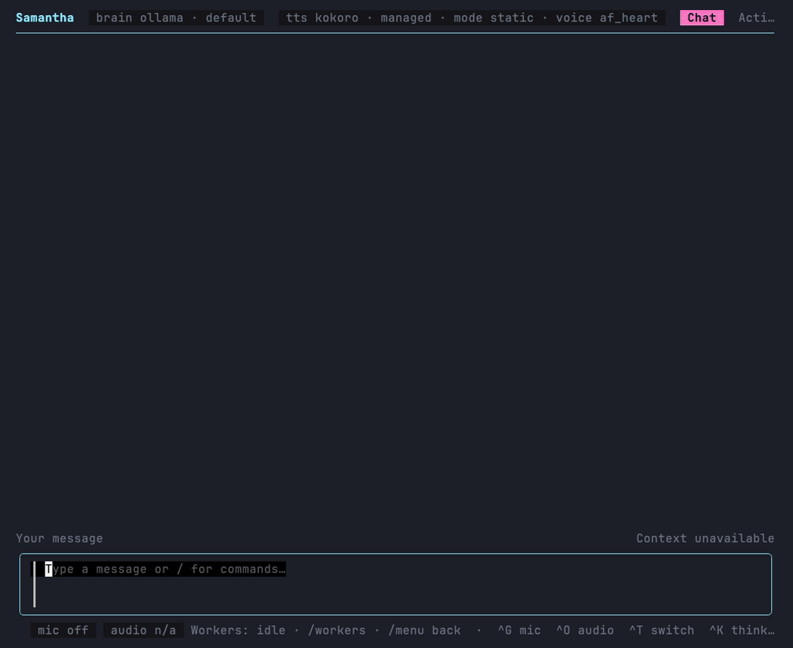

# Images and GIFs in chat

Paste an image or a local PNG, JPEG, or GIF path into the chat composer. Paths copied
from a terminal can be quoted or backslash-escaped, including screenshots with spaces
in their names. Imported images appear before you send and remain in the conversation
thread after sending. You can send images with a question or on their own.

## Terminal

- Paste with the normal clipboard shortcut, or use `/attach /path/to/image.png`.
- F2 pauses or resumes GIF previews. Reduced-motion mode shows a still frame.
- F3 opens the most recent draft image (or most recent thread image) at original size.
- F4 removes the last draft image. `/image N` opens thread image N, counting from one.

In Ghostty and kitty, still images are drawn at the terminal's own resolution through
the Kitty graphics protocol. Each image is sent to the terminal once and placed with
placeholder cells, so it scrolls and clips with the conversation, and a thread image
may use up to three quarters of the conversation pane. An image is never enlarged past
its own pixels. The terminal's copies are freed when the conversation is cleared and
when Obey Voice exits.

Everywhere else, and for animated GIFs in every terminal, inline previews use colored
half-blocks, so scrolling and tmux work without a terminal image protocol. These are
low-resolution thumbnails, not native bitmap rendering. Inside tmux, zellij or screen
the half-blocks are used even in Ghostty or kitty, because a multiplexer needs
passthrough turned on to carry the protocol. Set `OBEY_VOICE_TUI_IMAGES=blocks` to
always use half-blocks, or `OBEY_VOICE_TUI_IMAGES=kitty` to use the protocol in a
terminal or multiplexer setup that supports Kitty Unicode placeholders but is not
recognized.

Area averaging preserves thin detail when shrinking screenshots, and thread previews
use more rows in taller windows. Draft thumbnails scale with the available terminal
space. Use F3 to read screenshot text at full resolution. If the selected model cannot accept
images, one error stays beside the draft; the image and typed text remain available
to resend after changing models in Settings > Brain. Native bitmap clipboard import
is supported on macOS and Linux; pasted file paths also work where a bitmap clipboard
reader is unavailable. On Windows, open the stored file in your desktop image viewer.

## Desktop

Paste a clipboard image or file path while the composer is focused, or drop image files
into the conversation. Each preview has **Remove** and **Open original** controls.
GIFs animate in the composer and thread; **Pause GIFs** displays a still frame.
Copy a GIF file path or drop the file to preserve animation: an operating system's
bitmap clipboard may contain only one frame.

## Model input and saved conversations

Image input works with vision-capable Ollama models, the Codex app-server
adapter and the Claude CLI, including background workers and group conversations. The
actual recipient is validated before inference. Cursor, Grok, Muse Spark, and Obey
daemon adapters currently reject image input explicitly. GIFs send their first frame
as PNG; their original animation remains available in the UI. Codex replay resends
retained images when it starts a new native thread, with a 32 MiB aggregate limit.
Claude resends a persona's own earlier images when it starts a new CLI session, the
newest first, as many as fit in 20 images and 32 MiB; older, missing or oversized
ones are named as no longer attached instead of failing the request. A compaction
summary request resends none. Neither resends an image
attached to a line said to another persona: see
[Hosted backends](personas.md#hosted-backends).

Agents can return local PNG, JPEG, or GIF files created through their existing tools.
They attach files using a standalone Markdown image reference:

```markdown

```

The file must be inside the agent's work directory (or the existing attachment store).
The host validates and copies it into durable storage, replaces the reference with its
caption, and displays the preview with the reply. Up to four references are processed;
missing, invalid, out-of-directory, and remote images produce visible diagnostics.
Fenced examples and ordinary filenames do not import files. Paths are kept out of
speech. Image generation remains the responsibility of the agent's available tools.

Requests to find or create an image must reach a worker that can obtain the file.
Saying "attached below" or naming a directory does not attach anything. The live
Ollama router retries explicit image-delivery claims once if they contain neither
a file reference nor a tool call. A repeated unsupported claim produces an error
instead of entering speech and chat history. This shares the required routing
step's single retry; an honest refusal selects `route(kind=chat)` before answering.
When a live reply omits a route without an unsupported image claim, that retry uses
the same route schema as constrained JSON instead of asking for another native tool
call. Raw tool-call markup, including `<atem:function_calls>` invocations, is rejected
before reply text or speech; it is never interpreted as an executable tool call.
The host validates the decision before dispatch; a chat decision then gets a
fresh answer. Undecided prose and private routing JSON never become spoken replies.
The check uses the current request to recognize pronoun-only claims such as
"I've attached them below" and also validates the answer after `route(kind=chat)`.
An unsupported post-chat claim produces an error without another tool loop.
Post-chat answers to image requests wait for completion before speech so rejected
claims cannot leak through streaming; ordinary chat and workers retain incremental
streaming. This is not
a general verifier of everything a model says. Explicit file references still
pass through the normal file validation above.

Returned images also appear in worker threads and desktop background-result cards.
A queued worker keeps the images from its originating request; cancelling foreground
speech or switching personas does not retarget its images to a different conversation.
Outbound assets remain presentation attachments; Ollama sends user images as vision
input, while returned files keep their caption in subsequent model history.

Imports are copied into the session attachment store. Saved history contains references,
so deleting the source screenshot does not remove it from a resumed conversation.
Missing or changed stored assets produce an explicit error. Attachment storage is local;
sending a message supplies its images to the configured Ollama server, Codex or Claude provider.

Limits: four images per message, 8 MiB per image, 4096 pixels per side, 16 megapixels.
The size limit applies to an image as it is sent, so a GIF is measured as the PNG of
its first frame, which can be larger than the file. Claude takes at most 7.5 MiB per
image (10 MiB once encoded for the API); a larger image is refused before the request.
GIFs allow up to 64 frames and 16 megapixels of total logical-canvas work
(canvas width × canvas height × frame count), even when frames only update small
rectangles. This bounds compositing and preview downsampling; oversized animations
are rejected before rendering, including previously stored attachments. Preview caches are bounded;
older images can still be opened at full size. Desktop offers **Load preview** when its
cache is full. Removing an attachment from a draft does not delete the durable asset.

## Review recording and isolated verification


Run `just demo-chat-images` to reproduce the VHS recording. It runs the real Bubble Tea
conversation UI with deterministic image fixtures and a fake turn runner, no microphone,
audio, personal configuration, or remote model. The tape is `demos/chat-images.tape`.

For native UI acceptance, run `just test images` from `apps/desktop`, then launch the
printed **Obey Voice Images Test.app**. The fixture provides a screenshot, animated GIF,
temporary session storage, and a local vision stub. It records model requests under the
printed temporary directory so attachment transport can be checked as well as appearance.

### Agent reply recording



Run `just demo-agent-images` for the actual Bubble Tea UI with deterministic worker
completion events. This recording proves display and interaction; separate local HTTP
and app-server subprocess tests verify native image payloads, worker admission,
returned-file import, session persistence, and group handoff.

`go test ./internal/tui -run TestImageClaimRepairReachesTerminal` exercises an
unsupported claim, its correction into a worker call, file import, and both PNG
and GIF previews through the real pipeline and terminal loop with a local model
stub. To check routing with an installed Ollama model and isolated history, run:

```sh
OBEY_VOICE_IMAGE_ROUTING_MODEL=lfm3:1.7b go test -tags=integration ./pkg/voiceagent/brain -run TestLiveImageRequestsRouteToWorker -count=1 -v
```

This opt-in check makes local model requests but does not execute worker tools.
Set `OBEY_VOICE_IMAGE_ROUTING_TIERED=1` too to require an explicit worker tier.

After `just bundle` in `apps/desktop`, run
`python3 scripts/ui-fixture.py --agent-images` for a silent native app whose local
model stub returns both a PNG and an animated GIF. The isolated request log and saved
session files let reviewers verify input bytes and durable reply references.

### What the recordings establish

The recordings above were refreshed for PR #368 using the real Bubble Tea UI and
isolated, generated geometric fixtures. They show the current colored-character
thumbnail renderer, not full-resolution terminal graphics: the recording terminal
has no Kitty graphics protocol, so it shows the fallback.

| Behavior | Evidence |
| --- | --- |
| Pasted PNG path and clipboard GIF appear in the draft | `chat-images.gif`, with both previews visible before sending |
| GIF playback stops and resumes with F2 | Draft hint changes to **F2 play GIFs** while paused; the animated bar moves again after resume |
| Input attachments survive sending | Both previews appear beside the submitted user turn |
| Agent-returned PNG and GIF appear in chat | `agent-images.gif` shows `result.png` and `result.gif` after a fixture worker completion |
| Returned GIF stops and resumes | The returned bar stops near the end of the recording, then moves again |
| Video attachments/playback | Not implemented; the attachment importer accepts PNG, JPEG, and GIF only |
| Native desktop rendering | Not exercised by these terminal recordings; use the desktop fixture above |

The harness injects paste/key events and a deterministic worker result; it does not
exercise the operating system clipboard reader or prove a live model will create an
attachment. Tests separately cover import, durable storage, reply references, and
transport to the desktop projection.

For the refreshed GIF artifacts, FFmpeg frame hashes of just the animated preview
confirm movement, a still interval, and movement after resume:

| Recording | Playing interval / distinct frames | Paused interval / distinct frames | Resumed interval / distinct frames |
| --- | --- | --- | --- |
| `chat-images.gif` | 3.5–4.5 s / 7 | 5.6–6.5 s / 1 | 7.5–8.3 s / 7 |
| `agent-images.gif` | 12.5–13.5 s / 6 | 14.5–15.5 s / 1 | 16.5 s–end / 2 |

These counts sample at 12 fps and exclude the cursor and other UI. They apply to
these artifacts; rerunning the asynchronous UI harness can shift the timings.
Reproduce with `just demo-chat-images` and `just demo-agent-images`. Run the media
checks with:

```sh
go test ./internal/tui ./pkg/voiceagent/chatmedia ./pkg/voiceagent/session -run 'Media|Image|GIF|Thumbnail|Durable|Reply' -count=1
```
