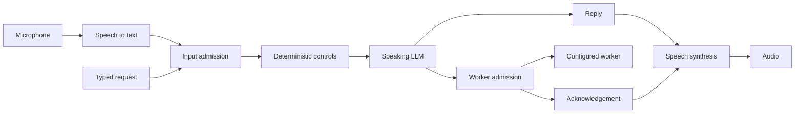
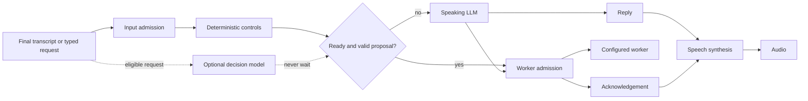

# Optional local decision routing

A decision model can answer “does this request need a worker, and which tier?”
while Obey Voice performs input admission. If the answer is ready and passes the
policy, Obey Voice can start the worker without asking the speaking LLM to route
that request. Otherwise it immediately follows its ordinary speaking-LLM path.

The experiment is **off by default**. Voice work, typed work and the addressee
question have independent switches. The model answers two questions: worker
routing, and, in a conversation with several personas, who is being addressed
(see below). It does not replace admission, transcription, the worker itself or
speech synthesis.

## Pipeline without optional decisions



## Pipeline with optional decisions



Existing control commands keep priority. Background notifications, continuations,
active work and narration bypass the optional decision. Rewritten input, changed
conversation/history/persona/worker settings, cancellation and disabling invalidate
its result. Worker permissions and queue policy remain enforced by normal worker
admission.

## Who is being addressed

In a shared conversation Obey Voice decides which persona a message is for.
Resolution runs in this order and stops at the first step that answers:

1. Exact controls (`@id`, `switch to Name`, `Hey Name`, a leading `Name,`).
   These never call a model. A message that names no persona also stops here
   and stays with the current persona.
2. The decision model, when `decision_enabled` and `decision_addressee` are on
   and the runtime is ready. It chooses one persona, nobody, or "ambiguous". A
   mention (`what did Mira say?`) is not an address.
3. The Ollama classifier, only when the live brain is Ollama. It also answers
   when the decision model fails, abstains or is not ready.
4. Otherwise the name grammar used before either model existed (for example
   `Santa tell me a story`), and failing that the current persona.

A persona running on any other backend (Claude, Codex, Cursor and so on) is never
asked to classify. If the decision model fails (it is still busy with an earlier
question, misses its deadline, returns an error or returns unusable output) and
the live brain is not Ollama, the turn is not failed: step 4 applies, exactly as
it did before the decision model existed, and one notice says the decision model
did not answer and why. Cancelling the turn still cancels it. An agent's reply
that invites another persona by name goes through the same steps; on a failure
without Ollama the reply stays with its speaker, with no notice (the diagnostic
below records it).

### What the addressee question sends

For every user message that names a persona (or carries a spoken-name hint) and
is not an exact control, and for every persona reply that names a persona (the
handoff check), the decision provider receives:

- the message or reply itself (up to 4,000 characters; longer ones are not sent);
- up to eight earlier messages of the conversation, each cut to 1,000
  characters, each labelled with its speaker's name (the human speaker's name,
  or the persona's display name for a persona reply);
- the speaker's name and whether the speaker is the user or a persona;
- the name of the persona currently answering;
- every persona name and alias in the conversation roster;
- the spoken-name hint from speech recognition, when there is one.

OpenAI also receives the private addressee instructions as its `instructions`
field. The data goes to whichever decision provider is configured: the local
model stays on this computer, while `jev` sends it to TypeSafe and `openai` sends
it to OpenAI. The worker-routing question already sends up to eight recent
messages (role and text) to the same provider; the addressee question adds
speaker and persona names and runs whenever a message names a persona, even with
both work switches off. `decision_addressee` defaults to on, so an existing setup
with a hosted provider starts sending it after upgrading. Turn it off with
`obey-voice config set decision_addressee false` or **Settings → Brain → Decide
who is addressed**; the Ollama classifier and the name grammar then answer as
before. With all three switches off nothing is prepared: no credential is read
and no model is installed or loaded.

### Thresholds and timing

The local and Jev answer is a probability distribution. It counts only when the
chosen option has confidence of at least 0.85 and leads the next option by at
least 0.20; otherwise the model abstains and step 3 or 4 answers (an abstention
is not "nobody"). A user message is treated as only a greeting (`bare`, answered
with "Name here.") when the model gives that at least 0.90. That is a single yes
probability, so 0.90 is already a 0.80 lead over "no"; it is stricter than the
target threshold because a wrong `bare` would drop the user's question. OpenAI
returns one categorical answer with no probability threshold. Changing a
threshold is a code change in `pkg/voiceagent/decision/addressee.go`.

The question waits for the model for at most `decision_budget_ms` (the work
question never waits) and runs alongside a work decision for the same message
rather than behind it. When the Ollama classifier answers after the decision
model, the two together are still bounded by `persona_routing_timeout`, not by
the sum of both limits. A message the absent-person option fits ("unavailable")
is answered by the current persona, as the Ollama classifier's instructions also
require. The two questions are separate calls; they could be combined into one
request per turn later, but are not.

When the decision model or the Ollama classifier is configured, each message or
reply that names a persona emits a `decision.evaluated` diagnostic with point
`addressee`, the decision model's outcome as its disposition (`answered`,
`abstained`, `skipped`, `busy`, `timeout`, `provider_error`, `invalid_output`,
`cancelled`, or `not_asked` when the decision model is off), the step that
settled it as `resolver` (`decision_model`, `ollama_classifier`, `grammar`,
`current_persona`, or `failed`) and the total elapsed time. It carries no message
text or names.

Accuracy of this question on real speech has not been measured, and the 750 ms
default may be short for a cold model or a long conversation.

## Enable and manage

Open **Settings → Brain → Decision shortcuts (experimental)**. Choose the provider
and runtime. For managed local decisions, install the selected model using
**Local decision model setup**, then enable decision routing. Local + managed is
the default selection. Startup verifies and
loads installed assets in the background; it never downloads, installs or repairs
them. Missing or corrupt assets leave optional decisions unavailable with setup
guidance, while ordinary routing remains available. The settings show
preparation/readiness/failure state. Starting a conversation, enabling decisions,
or changing their model/device selection does not trigger installation.
Disable the master switch to cancel optional work and stop its owned server.
Voice, text and addressee switches can be changed independently and persist
across restarts. With all three off, an enabled master switch prepares nothing.

The equivalent persisted configuration keys are:

| Key | Default | Meaning |
| --- | --- | --- |
| `decision_enabled` | `false` | Master switch |
| `decision_voice_work` | `true` | Voice worker routing |
| `decision_text_work` | `true` | Typed worker routing |
| `decision_addressee` | `true` | Who a message naming a persona is for |
| `decision_provider` | `local` | `local`, `jev`, or `openai` |
| `decision_runtime` | `managed` | Managed install or `external` local server |
| `decision_local_model` | `2b` | `2b`, `0.8b`, `decider-2b-v12`, `decider-4b-v3`, or `d1-3b` |
| `decision_device` | `auto` | `auto`, `cpu`, `mps`, or `cuda`; managed local only |
| `decision_endpoint` | empty | External loopback `/v1/systemone` URL |
| `decision_model` | empty | Explicit hosted model ID |
| `decision_api_key` | empty | Hosted credential (masked in settings) |
| `decision_budget_ms` | `750` | Inference deadline; only the addressee question waits for it |
| `decision_policy` | `route_choice` | Local/Jev question policy; also `intent_and_tier` |

Use `obey-voice config KEY VALUE` to persist a key. With managed decisions
enabled, `obey-voice models ensure --decision` installs just their assets, and
`obey-voice models status --decision` checks the GGUF weights and verified native
runtime. Initial setup downloads checksum-pinned native archives and model files.
Inference runs locally with offline model loading. A Go adapter exposes only the
typed decision endpoint; the underlying llama.cpp server uses a private Unix
socket. Setup and inference do not install or launch Python, uv, pip or PyTorch.
Legacy decision environments and weights are preserved but never treated as
native-ready. Run setup explicitly after upgrading.

Each managed decision server has an independent supervisor tied to its owning
Obey Voice process by an inherited lifetime pipe. If the app crashes or is
force-quit, the supervisor terminates that server and its subprocesses, including
a worker stuck in inference. Normal cancellation also stops the owned process
group. Other sessions' decision servers, external endpoints, and Ollama models
have separate lifetimes. This protection applies to newly started managed
servers; upgrading does not terminate orphaned workers from older versions.

The original `2b` and `0.8b` IDs keep their pinned weights. `2b` remains the
default, and decision shortcuts remain off until enabled. New catalog entries
are experimental alternatives, not automatic upgrades. Settings display download
size, a memory planning estimate, and license. Liquid d1 uses the
[LFM Open License](https://huggingface.co/LiquidAI/d1-3B/blob/main/LICENSE),
which has commercial restrictions; the Decider entries use Apache-2.0.

Auto chooses MPS on Apple Silicon, detected NVIDIA CUDA on Linux x86_64, and
CPU otherwise. An explicit unavailable device fails with a diagnostic; it never
silently changes model or selects a hosted provider. Managed macOS requires
Apple Silicon and macOS 14 or later. The pinned Linux runtime requires glibc
2.38+, libstdc++ providing GLIBCXX_3.4.32/CXXABI_1.3.15, OpenSSL 3 and libgomp
(Ubuntu 24.04 or Debian 13 satisfy these dependencies). Debian 12 and older
glibc 2.28 installations need an external compatible server. Linux
ARM64 uses CPU; managed CUDA on ARM64, Intel macOS, and Windows are not supported.
Those systems can use an external compatible loopback server. Linux backend
selection has fixture coverage; live hardware validation is on Apple Silicon.

Managed setup pins source and GGUF model revisions, file SHA-256 checksums and
llama.cpp b11669 native archives. Full-precision F16/BF16 files preserve the
catalog's model selections; quantized substitutes are not used. Runtime
directories are isolated by version, platform and compute device. CUDA uses the
pinned CUDA 12.8 runtime libraries under NVIDIA's CUDA Toolkit EULA. Only the
selected model is downloaded. Changing
settings cancels prior setup/inference and returns to ordinary routing until
the new runtime is ready.

Once ready, **Test on this machine** runs one synthetic choice on the owned
local runtime, with no conversation data or tools. It reports elapsed time
against the configured deadline. This is a warm smoke test, not a routing
accuracy benchmark or a guarantee that longer requests meet the deadline.
Hosted and external runtimes cannot use this test action.

Jev and OpenAI are explicit alternatives. Selecting either sends the bounded
request and recent conversation to that service and may incur its API charges;
with `decision_addressee` on, that includes the addressee question described
above.
They require a model ID and credential; `DECISION_API_KEY` is read only for an
enabled hosted provider. Local mode ignores hosted credentials, and failures
never select a hosted provider automatically. OpenAI uses strict categorical
structured output with `store: false`; it has no probability threshold. Hosted
adapters have fixture coverage, not a live paid-service performance result.

## Experiment boundaries

The current conservative policy accepts only a subset of work requests. It uses
at most eight history messages and bypasses longer conversations rather than
silently dropping constraints. (The addressee question instead sends the latest
eight, each cut to 1,000 characters.) Ambiguous, malformed, unavailable-tier and
low-confidence results fall back. The 2B model is the tested default; the smaller
model is available for comparison. Neither is a correctness guarantee.

The shortcut needs enough existing admission/preparation time for its result to
arrive. A host with immediate admission usually reaches the ordinary LLM before
a decision is ready. Parallel execution avoids a deliberate inference wait, but CPU/GPU contention can
still slow admission or speech on some machines. Keep the experiment off unless
its measured tradeoff works for your setup. A `decision.evaluated` diagnostic
reports disposition, model, elapsed inference time and proposed tier without
transcript contents; it is included in conversation recordings. Ordinary route events show whether the host actually accepted
that proposal.

See the [retained pipeline comparison](benchmarks/decision-routing-2026-10-02/README.md)
for measured benefits, slower non-shortcut observations and missing-audio cases.

## Reproduce the actual pipeline comparison

Install the managed model and Kokoro into an isolated model directory. Start local
Ollama with the intended speaking model. The recipe defaults to the 24 labeled
cases in `testdata/decision/worker-routing.json`. To use your own corpus, supply
`OBEY_DECISION_CASES` as a labeled JSON array of cases:

```json
[{"id":"version","state":{"latest_user_message":"Please execute python3 --version.","recent_conversation":[],"enabled_worker_tiers":["simple","medium","complex"]},"want":{"work":true,"tier":"simple"}}]
```

Then run:

```sh
OBEY_DECISION_MODELS=/absolute/path/to/isolated/models \
OBEY_DECISION_OUT=/absolute/path/to/new-results.jsonl \
OBEY_DECISION_BRAIN_MODEL=qwen3.8:latest \
just bench decision-pipeline
```

The integration harness uses actual admission and speaking-model HTTP calls,
production voice routing/worker admission, real Kokoro synthesis, and a controlled
worker that writes a temporary marker. It records call counts, first PCM,
worker-entry time, route correctness and errors. The baseline/optional order is
balanced over four passes; `OBEY_DECISION_REPS` and `OBEY_DECISION_CASE_IDS` can
select a smaller smoke run. Existing result paths are refused.

Timing starts with a fixture's finalized transcript. First PCM means genuine audio
frames reaching a software sink, not sound reaching a listener. Microphone/STT
latency and full worker execution are outside this measurement. Retain failures
and compare matching case/repetition pairs; a passing harness means data was
collected, not that every request was routed correctly or that latency improved.

## Install a model before enabling decisions

In the TUI, open Settings → Brain, choose the local model and compute device,
and set **Model storage / existing models** to your preferred model root (for
example, a directory on a fast external drive). **Check installed model / verify**
checks the selected pinned files without downloading. **Install / repair selected
model** downloads missing files, reuses verified files, and repairs corrupt files.
Progress appears in Settings; **Cancel model setup** stops setup. The same install
button retries after cancellation or failure. Turn off live decision routing
before running setup.

In the desktop app, Settings → Brain → **Local decision model setup** provides
model/device/storage choices and the same verify/install actions. Save each
choice before installing. Progress, results and Cancel appear in the task panel.
Stop an active conversation before setup. Check shows model size, approximate
memory, license and installation state. Runtime dependencies require additional
disk space beyond the listed model download.

Both interfaces use the shared engine installer without enabling routing. The
storage directory is shared with speech models. Selecting a directory does not
move files: choose an existing Obey Voice model root to reuse its verified assets;
arbitrary model formats are not imported. Existing files on another drive can
remain there. The equivalent commands are `obey-voice models decision status`
and `obey-voice models decision install`.
