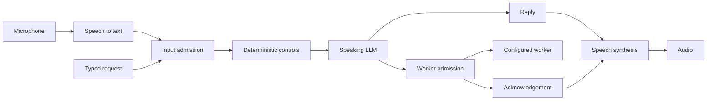
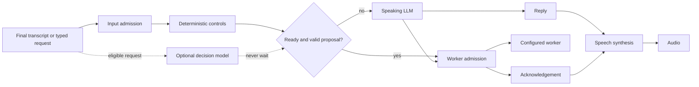

# Optional local decision routing

A decision model can answer “does this request need a worker, and which tier?”
while Obey Voice performs input admission. If the answer is ready and passes the
policy, Obey Voice can start the worker without asking the speaking LLM to route
that request. Otherwise it immediately follows its ordinary speaking-LLM path.

The experiment is **off by default**. Voice and typed requests have independent
switches. It currently proposes worker routing; it does not replace admission,
transcription, the worker itself or speech synthesis.

## Pipeline without optional decisions



## Pipeline with optional decisions



Existing control commands keep priority. Background notifications, continuations,
active work and narration bypass the optional decision. Rewritten input, changed
conversation/history/persona/worker settings, cancellation and disabling invalidate
its result. Worker permissions and queue policy remain enforced by normal worker
admission.

## Enable and manage

Open **Settings → Brain → Decision shortcuts (experimental)**. Choose the provider and runtime,
then enable decision routing. Local + managed is the default selection. Preparation
runs in the background; the normal pipeline remains available while the model is
installing or starting. The settings show preparation/readiness/failure state.
Disable the master switch to cancel optional work and stop its owned server.
Voice and text switches can be changed independently and persist across restarts.

The equivalent persisted configuration keys are:

| Key | Default | Meaning |
| --- | --- | --- |
| `decision_enabled` | `false` | Master switch |
| `decision_voice_work` | `true` | Voice worker routing |
| `decision_text_work` | `true` | Typed worker routing |
| `decision_provider` | `local` | `local`, `jev`, or `openai` |
| `decision_runtime` | `managed` | Managed install or `external` local server |
| `decision_local_model` | `2b` | Managed `2b` or `0.8b` model |
| `decision_endpoint` | empty | External loopback `/v1/systemone` URL |
| `decision_model` | empty | Explicit hosted model ID |
| `decision_api_key` | empty | Hosted credential (masked in settings) |
| `decision_budget_ms` | `750` | Inference deadline; never a pipeline wait |
| `decision_policy` | `route_choice` | Local/Jev question policy; also `intent_and_tier` |

Use `obey-voice config KEY VALUE` to persist a key. With managed decisions
enabled, `obey-voice models ensure --decision` installs just their assets, and
`obey-voice models status --decision` checks the weights, installer and private
Python environment. Initial setup downloads public model/runtime dependencies.
Subsequent inference runs locally with offline model loading and a private
loopback listener. Setup does not alter the user's Python installation.

Managed setup pins model revisions, model/source/archive SHA-256 checksums,
Python and dependency versions. It was exercised on Apple Silicon macOS. Linux
amd64/arm64 installer selection uses CPU PyTorch but has not been verified on
Linux hardware. Other platforms can use an external compatible loopback server.

Jev and OpenAI are explicit alternatives. Selecting either sends the bounded
request and recent conversation to that service and may incur its API charges.
They require a model ID and credential; `DECISION_API_KEY` is read only for an
enabled hosted provider. Local mode ignores hosted credentials, and failures
never select a hosted provider automatically. OpenAI uses strict categorical
structured output with `store: false`; it has no probability threshold. Hosted
adapters have fixture coverage, not a live paid-service performance result.

## Experiment boundaries

The current conservative policy accepts only a subset of work requests. It uses
at most eight history messages and bypasses longer conversations rather than
silently dropping constraints. Ambiguous, malformed, unavailable-tier and
low-confidence results fall back. The 2B model is the tested default; the smaller
model is available for comparison. Neither is a correctness guarantee.

The shortcut needs enough existing admission/preparation time for its result to
arrive. A host with immediate admission usually reaches the ordinary LLM before
a decision is ready. Parallel execution avoids a deliberate inference wait, but CPU/GPU contention can
still slow admission or speech on some machines. Keep the experiment off unless
its measured tradeoff works for your setup. A `decision.evaluated` diagnostic
reports disposition, model, elapsed inference time and proposed tier without
transcript contents; it is included in conversation recordings. Ordinary route events show whether the host actually accepted
that proposal.

See the [retained pipeline comparison](benchmarks/decision-routing-2026-10-02/README.md)
for measured benefits, slower non-shortcut observations and missing-audio cases.

## Reproduce the actual pipeline comparison

Install the managed model and Kokoro into an isolated model directory. Start local
Ollama with the intended speaking model. The recipe defaults to the 24 labeled
cases in `testdata/decision/worker-routing.json`. To use your own corpus, supply
`OBEY_DECISION_CASES` as a labeled JSON array of cases:

```json
[{"id":"version","state":{"latest_user_message":"Please execute python3 --version.","recent_conversation":[],"enabled_worker_tiers":["simple","medium","complex"]},"want":{"work":true,"tier":"simple"}}]
```

Then run:

```sh
OBEY_DECISION_MODELS=/absolute/path/to/isolated/models \
OBEY_DECISION_OUT=/absolute/path/to/new-results.jsonl \
OBEY_DECISION_BRAIN_MODEL=qwen3.8:latest \
just bench decision-pipeline
```

The integration harness uses actual admission and speaking-model HTTP calls,
production voice routing/worker admission, real Kokoro synthesis, and a controlled
worker that writes a temporary marker. It records call counts, first PCM,
worker-entry time, route correctness and errors. The baseline/optional order is
balanced over four passes; `OBEY_DECISION_REPS` and `OBEY_DECISION_CASE_IDS` can
select a smaller smoke run. Existing result paths are refused.

Timing starts with a fixture's finalized transcript. First PCM means genuine audio
frames reaching a software sink, not sound reaching a listener. Microphone/STT
latency and full worker execution are outside this measurement. Retain failures
and compare matching case/repetition pairs; a passing harness means data was
collected, not that every request was routed correctly or that latency improved.
