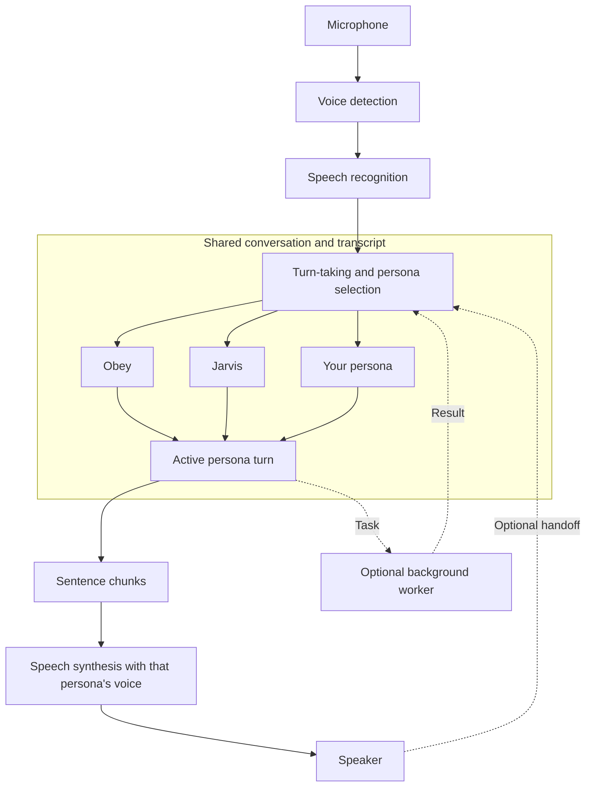

# Voice stack

With local speech providers and Ollama, the conversation path runs on your hardware. Background workers can use a different model or provider. A remote brain or worker sends its requests to that provider.

In an Ollama group chat, several personas share a transcript and take turns speaking. Each has its own prompt, model, and voice. The diagram shows three example personas; you choose the roster. An agent can hand the floor to another, and your interruption takes priority. [Persona setup](personas.md) · [Turn-taking and handoffs](context-continuity.md#addressing-and-handing-over-the-floor).

Speech starts as sentences arrive. The latency target is under 2 seconds from the end of your utterance to first audio; actual timing depends on your hardware, model, and provider.

| Layer | Default | Options |
|-------|---------|---------|
| Brain | Local models via Ollama | Claude Code, [Codex](codex.md), Cursor, Grok, [Muse Spark](muse-spark.md), [Obey daemon](obey-daemon.md) |
| STT | NVIDIA Parakeet TDT (sherpa-onnx) | Whisper (`sherpa`), Zipformer streaming, whisper.cpp |
| TTS (four providers) | Kokoro (sherpa-onnx) | Native Qwen3-TTS, [Audio8](audio8-voices.md) (experimental), [OpenAI-compatible speech](openai-speech.md) (including Phonon via Ollama) |
| VAD | Silero | |
| Audio | miniaudio / malgo | |

Models download on first use into `models_dir`, and `just install` runs `models ensure` for the default Kokoro/STT/VAD stack. Qwen installs from TUI Settings or `obey-voice models ensure --tts` on macOS Apple Silicon (Metal) and linux/amd64 (CPU). The default speech stack and native Qwen3-TTS need no Python runtime.
